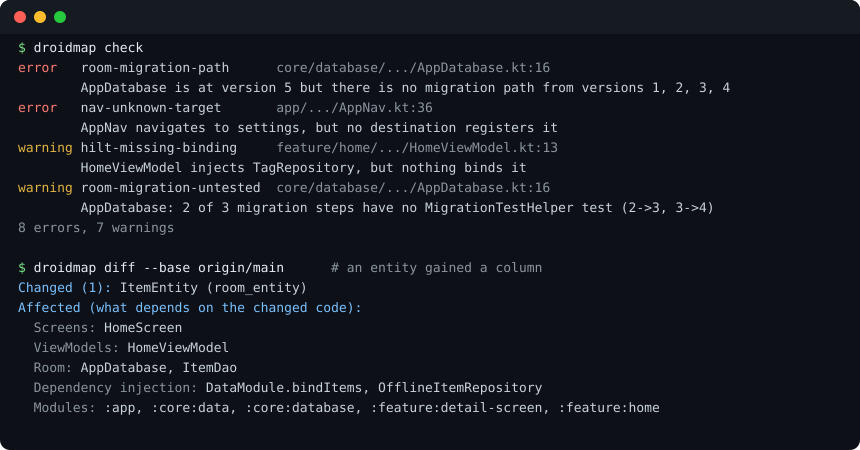

# droidmap

[](https://github.com/hussainshirazi/droidmap/actions/workflows/ci.yml)
[](LICENSE)

**An Android-aware map of your project, for you, your pull requests and your AI coding agent.**

Generic code graphs see classes and calls. They do not see that:

- version 4 of your Room database has no migration to version 5, so users on 4 crash on update;
- an entity gained a column but the database version was not bumped, which crashes on update too;
- your migration test is named `migrationFrom1To4` but runs 1→2→3→4, while users on version 1 get `MIGRATION_1_4`, which no test runs;
- `navigate("settings")` points at a route no `NavHost` registers;
- a ViewModel injects a repository that nothing binds, in Hilt or in Koin (a crash at runtime with Koin);
- a library added `ACCESS_NETWORK_STATE` to your merged manifest;
- a feature module gets `:core:data` through a convention plugin in `build-logic`, which your module rules forbid.

droidmap reads the Android wiring directly (Gradle, Room, Navigation, Hilt, Koin, the manifest, in Kotlin and Java) and turns it into a graph. Run its rules in CI, get a comment on every pull request saying what the change touches, ask it what depends on a class before you change it, and hand it to an AI agent over MCP.

It reads source files only: it never runs Gradle, never compiles your code and never sends anything anywhere.



## Install

macOS or Linux:

```sh
curl -fsSL https://raw.githubusercontent.com/hussainshirazi/droidmap/main/install.sh | sh
```

Windows (PowerShell):

```powershell
irm https://raw.githubusercontent.com/hussainshirazi/droidmap/main/install.ps1 | iex
```

Homebrew: `brew tap hussainshirazi/droidmap https://github.com/hussainshirazi/droidmap` then `brew install droidmap`. Scoop: `scoop bucket add droidmap https://github.com/hussainshirazi/droidmap` then `scoop install droidmap/droidmap`.

Or download `droidmap.jar` from the [latest release](../../releases/latest) and run `java -jar droidmap.jar`. droidmap needs Java 17 or newer; Android Studio already has one in its `jbr` folder (set `JAVA_HOME` to it). The jar is about 65 MB because it carries the Kotlin compiler's parser.

## Quick start

From your project's root:

```sh
droidmap check                    # run the rules; exit code 1 on errors
droidmap impact TopicEntity       # what depends on it, transitively
droidmap diff                     # what your uncommitted changes touch
droidmap diff --base main         # what your branch touches
droidmap report -o REPORT.md      # an overview, with module and screen-flow diagrams
```

## On pull requests (GitHub Action)

```yaml
name: droidmap
on: [push, pull_request]

jobs:
  droidmap:
    runs-on: ubuntu-latest
    permissions:
      contents: read
      security-events: write   # findings as code scanning alerts
      pull-requests: write     # the comment that says what the pull request touches
    steps:
      - uses: actions/checkout@v4
      - uses: hussainshirazi/droidmap@v0
```

On each pull request the Action comments with what the change touches, and updates that one comment on every push:

> ### droidmap: what this change touches
>
> Compared with `origin/main`: 1 changed file, 1 of them read by droidmap.
>
> **Changed** (1): `ItemEntity` room_entity
>
> **Affected** (what depends on the changed code):
>
> | | |
> |---|---|
> | Screens | `HomeScreen` |
> | ViewModels | `HomeViewModel` |
> | Room | `AppDatabase`, `ItemDao` |
> | Dependency injection | `DataModule.bindItems`, `OfflineItemRepository` |
> | Modules | `:app`, `:core:data`, `:core:database`, `:feature:detail-screen`, `:feature:home` |

Findings show up as code scanning alerts, as notes on the changed lines and in the job summary, and the step fails on errors. The Action needs no Java setup: it uses the JDK that GitHub's runners already have. To check the merged manifest's permissions as well, run a Gradle build (for example `./gradlew :app:processReleaseManifest`) before it.

| Input | Default | |
|---|---|---|
| `path` | `.` | the Android project's folder, when it is not the repository root |
| `fail-on` | `error` | `warning` or `info` to be stricter, `never` to only report |
| `comment` | `true` | `false` to keep the impact summary out of pull request comments (it stays in the job summary) |
| `upload-sarif` | `true` | `false` on a private repository without GitHub Advanced Security (code scanning is free on public ones) |
| `args` | | extra arguments for `droidmap check`, such as `--config tools/droidmap.toml` |
| `base` | `auto` | the git ref to compare with: `auto` is a pull request's base branch, `none` turns it off; another ref must be fetched (for example with `fetch-depth: 0`) |
| `version` | the pinned release | a droidmap release such as `0.2.0` |

## With an AI agent (MCP)

`droidmap mcp` is a [Model Context Protocol](https://modelcontextprotocol.io) server over stdio. It rebuilds the graph when a file changes (parsing only the changed files), so its answers follow the code as the agent edits it.

Claude Code:

```sh
claude mcp add droidmap -- droidmap mcp .
```

Cursor, VS Code, Windsurf and other clients take the same command in their MCP config (`"command": "java", "args": ["-jar", "/path/to/droidmap.jar", "mcp", "."]` works without installing):

```json
{ "mcpServers": { "droidmap": { "command": "droidmap", "args": ["mcp", "."] } } }
```

| Tool | Use it to |
|---|---|
| `droidmap_impact` | see what depends on an entity, route, ViewModel, binding or module before changing it |
| `droidmap_diff` | see what the uncommitted changes (or a branch) touch, and which tests cover them |
| `droidmap_check` | run the rules after a change |
| `droidmap_show` | look at one node: its attributes, dependencies and users |
| `droidmap_find` | search nodes by name |
| `droidmap_report` | get a Markdown overview of the project |

## What droidmap understands

| Area | What it reads |
|---|---|
| **Gradle** | Modules from `settings.gradle(.kts)`; `project(":x")` and type-safe `projects.x.y` dependencies in Kotlin DSL and Groovy; plugins from the version catalog; the project dependencies that **convention plugins in an included build** (`build-logic`) add to every module that applies them; and Kotlin Multiplatform source sets (a dependency in `commonTest` is a test dependency). |
| **Room** | Databases, entities, DAOs (the tables each `@Query` uses and the entities each `@Insert`, `@Update`, `@Delete` or `@Upsert` writes, inherited ones included), manual and auto migrations, the exported schema JSON, the columns each entity has compared with that JSON, and **which `MigrationTestHelper` test covers which migration step**. |
| **Navigation** | Compose Navigation with string routes (built from constants, templates and helper functions) or type-safe routes, **Navigation 3** (`entry<Key>`), XML navigation graphs (across files, with deep links and menu items), and `navigate(...)` calls in Kotlin and Java, including calls through your own helpers such as `navigateToTab(route)`. |
| **Hilt** | `@HiltViewModel`s, `@Inject` constructors and fields, `@Provides` and `@Binds` with qualifiers, entry points, and which screens, activities and fragments use which ViewModel. |
| **Koin** | Modules and definitions (`single`, `factory`, `viewModel`, `singleOf(::X)`, `bind`), Koin Annotations (with JSR-330), and what each definition gets with `get()`; `koinViewModel`, `koinInject` and `by inject()` uses. |
| **Manifest** | Permissions (including `tools:node="remove"`) and components from the source manifests, and, when a build has produced it, the merged manifest's permissions with the library that added each. |

Kotlin and Java are read with the Kotlin compiler's own parser (the one detekt and ktlint use), on several threads.

## Commands

```sh
droidmap check  [path] [--format text|json|sarif] [--fail-on error|warning|info|never] [--sarif FILE] [--base REF]
droidmap impact <node> [path] [--depth N] [--json]   # what depends on a node
droidmap diff   [path] [--base REF] [--depth N] [--format text|markdown|json]   # what a change touches
droidmap show   <node> [path] [--json]               # a node, its dependencies and its users
droidmap find   <text> [path] [--limit N] [--json]   # search nodes
droidmap report [path] [-o FILE]                     # the Markdown report, with Mermaid diagrams
droidmap build  [path] [-o DIR] [--node-link]        # write droidmap-out/graph.json and REPORT.md
droidmap rules                                       # list the rules and their default severities
droidmap mcp    [path]                               # run the MCP server over stdio
```

`<node>` can be an id, a name or part of a name: `TopicEntity`, `:core:data`, `"editor?id={id}"`, `HomeViewModel`. `check`, `impact`, `show`, `find` and `report` also take `--config FILE` and `--graph FILE` (use a saved `graph.json` instead of scanning); `build`, `diff` and `mcp` take `--config FILE`.

`diff` compares the working tree (committed or not, new files included) with the point where your branch left `--base` (default `HEAD`: the uncommitted changes). A changed line counts for the innermost declaration around it, so editing one function does not mark its whole class.

`check --sarif FILE` also writes the findings as SARIF. `check --base REF` also compares Room schema files with that commit; your last release tag is the most precise choice, since only a shipped schema must never change. Add `droidmap-out/` to your `.gitignore` if you use `build`.

Exit codes: 0 when done, 1 when `check` finds something at `--fail-on` or above (or `find` matches nothing), 2 for a usage or config error, 3 for an internal error.

## Rules

| Rule | Default | Finds |
|---|---|---|
| `room-migration-path` | error | a known schema version with no migration path to the current version |
| `room-schema-missing` | warning | no exported schema JSON for the current version or an earlier one |
| `room-schema-stale` | warning | entities that no longer match the schema JSON of the current version: a changed entity without a version bump crashes on update |
| `room-schema-changed` | warning | with `--base REF`: the schema JSON of a version that already existed at `REF` changed, which is the same crash once that version has shipped |
| `room-migration-untested` | warning | migration steps no `MigrationTestHelper` test runs |
| `room-migration-unused` | warning | a manual `Migration` that app code never uses (not passed to `addMigrations`?), even if a test runs it |
| `room-destructive-fallback` | warning | `fallbackToDestructiveMigration()`, which deletes user data |
| `room-insert-replace` | off | `@Insert(onConflict = REPLACE)`, which deletes and re-inserts rows |
| `nav-unknown-target` | error | `navigate()` to a route or key no destination registers |
| `nav-unreachable` | warning | a destination nothing navigates to, starts at or refers to, and that no deep link or menu item opens |
| `hilt-missing-binding` | warning | an injected project type with no `@Inject` constructor, `@Provides` or `@Binds` |
| `hilt-duplicate-binding` | error | the same type and qualifier bound twice in one source set |
| `koin-missing-definition` | warning | a type Koin is asked for (`get()`, `inject()`, `koinInject()`) that no Koin definition provides: `NoDefinitionFoundException` at runtime |
| `gradle-unknown-project` | error | a project dependency on a module settings does not include |
| `gradle-forbidden-dependency` | error | a dependency your `[[gradle.forbid]]` rules ban |
| `gradle-cycle` | error | modules that depend on each other in a cycle |
| `manifest-permission` | error | a permission not in your `allowed_permissions`, in a source manifest or added by a library to the merged one |

## Configuration

Put a `.droidmap.toml` at the project root (all of it is optional):

```toml
[rules]
"room-migration-untested" = "error"   # error | warning | info | off
"room-insert-replace" = "error"

[manifest]
allowed_permissions = ["android.permission.INTERNET", "android.permission.POST_NOTIFICATIONS"]

[[gradle.forbid]]
from = ":feature:*"
to = ":feature:*"
reason = "features talk to each other through :core modules"

[ignore]
paths = ["benchmarks/**"]
```

An unknown rule name or severity is an error, so a typo never leaves a rule silently unchanged. `from`, `to` and `ignore.paths` are glob patterns where `*` also matches `:` and `/`. A forbid rule skips test dependencies unless it says `tests = true`, and `allow_same_parent = true` lets siblings such as `:feature:a:impl` and `:feature:a:api` depend on each other. With `allowed_permissions`, a permission a library adds to the merged manifest is reported with the library's name, so you can remove it (`tools:node="remove"`) or allow it.

## The graph

`droidmap build` writes `droidmap-out/graph.json` (schema `droidmap/1`) with three lists:

- `nodes`: id, kind, label, file, line, module and attrs;
- `edges`: source, target, kind, file, line and attrs;
- `unresolved`: what static analysis could not follow, with the reason.

An edge always means *source depends on target*, so impact is a walk backwards. Paths are relative to the project root and the output is deterministic, so it diffs cleanly. `--node-link` also writes the networkx node-link shape that tools such as graphify read.

Node kinds: `module`, `room_database`, `room_entity`, `room_dao`, `room_migration`, `room_schema`, `test`, `nav_destination`, `nav_route`, `screen`, `function`, `viewmodel`, `injectable`, `hilt_module`, `hilt_provider`, `koin_module`, `koin_definition`, `entry_point`, `component`, `permission`, `class`.

Edge kinds: `depends_on`, `contains_entity`, `contains_dao`, `queries`, `writes`, `has_schema`, `migrates`, `tests`, `registers`, `shows`, `navigates_to`, `starts_at`, `uses_viewmodel`, `injects`, `bound_by`, `requires`, `declared_in`, `uses_permission`, `declares`.

## Limits

droidmap is static and deliberately conservative. When it cannot resolve something (a route held in a variable, a version that is not a constant, a Koin definition whose type it cannot tell), it records it under `unresolved` instead of guessing, and the rules do not fire on it.

- Generated code (KSP, kapt, Safe Args directions) is not read.
- The merged manifest is read only when a build has produced it (`<module>/build/intermediates/merged_manifests/`); droidmap does not run Gradle. A merged manifest older than the build files is flagged as such.
- Names resolve through imports, the same package and unique simple names, without type inference: two project classes with the same simple name and no import can be confused.
- Navigation arguments built at runtime and `NavEntry` objects built by hand in Navigation 3 are not followed; helper functions are followed one level deep. Koin's `@ComponentScan` packages are not checked: with Koin Annotations, every annotated class counts as a definition.
- `diff` maps changed lines to declarations; a change that only deletes a declaration shows as a change to what surrounds it.

## Contributing

```sh
./gradlew test fatJar        # run the tests and build build/libs/droidmap.jar
```

The code lives in `src/main/kotlin/droidmap`. `KotlinReader` and `JavaReader` read each file into one language-neutral model (`Model.kt`); the extractors in `extract/` (Gradle, Room, Navigation, Hilt, Koin, Manifest) turn the model into the graph; the rules are in `Checks.kt`, queries in `Query.kt`, `diff` in `Diff.kt`, the report in `Report.kt` and the MCP server in `Mcp.kt`. The tests run every rule against a small synthetic project in `src/test/resources/sample` and small projects written per case (`CasesTest`); a new rule or a fixed false positive should come with a case.

Ideas and bug reports are welcome in the issues. A small snippet that reproduces the problem helps most.

## License

Apache-2.0. See [LICENSE](LICENSE).
